<div align="center">

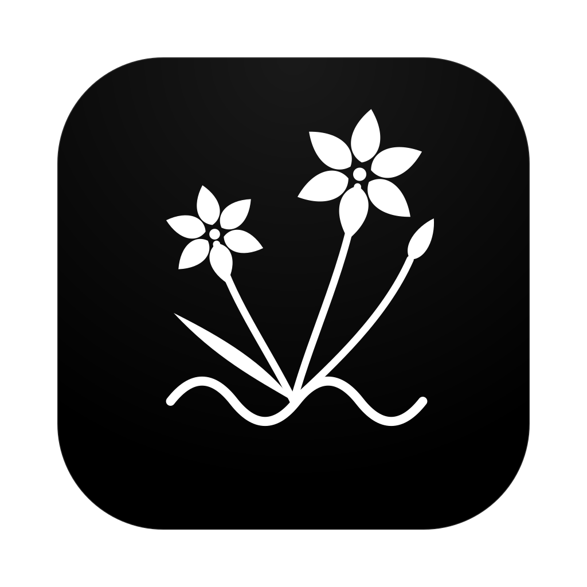

# Beatrice

### Become any voice. In real time.

The official website for **Beatrice**, the free, open-source real-time AI voice changer for **Mac** and **Windows**.<br/>
112 voices · ultra-low latency · runs entirely on your computer.

<br/>

[](https://project-beatrice.vercel.app/)
[](https://github.com/Project-Beatrice-V2)
[](https://github.com/Project-Beatrice-V2/Beatrice-website/deployments)
[](LICENSE)

**[Website](https://project-beatrice.vercel.app/)** · **[Download](https://project-beatrice.vercel.app/download)** · **[All 112 voices](https://project-beatrice.vercel.app/voices)** · **[Guides](https://project-beatrice.vercel.app/docs)** · **[About](https://project-beatrice.vercel.app/about)**

<br/>

<a href="https://project-beatrice.vercel.app/">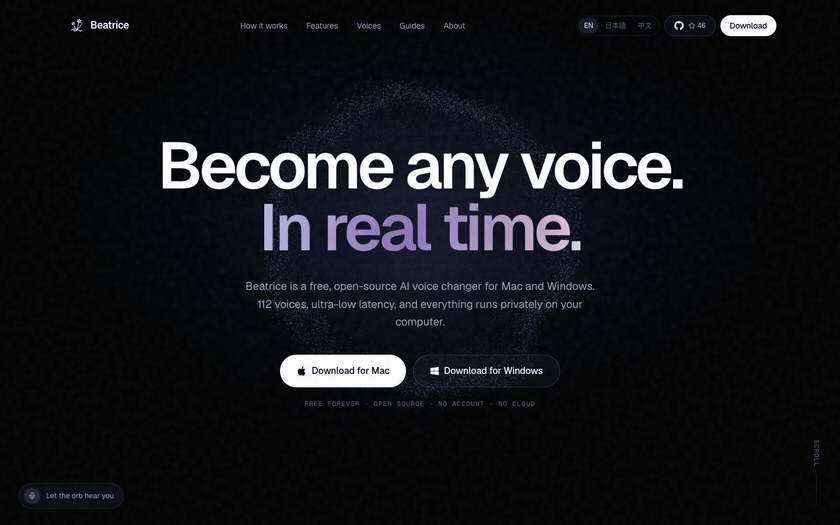</a>

<sub>The hero is a live WebGL scene of ~26,000 particles. Click <b>“Let the orb hear you”</b> on the site and it reacts to your own voice. Audio is analysed in your browser and never sent anywhere.</sub>

</div>

---

## ✦ Scroll the story

One particle "voice" lives behind every page, and scrolling reshapes it. A grey, turbulent **orb** (your raw voice) settles into a smooth aurora (the converted voice), unspools into a glowing **waveform** for the latency moment, and opens into a **ring** around the final call to action.

<div align="center">
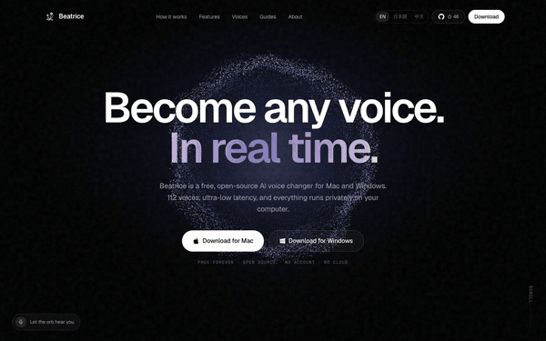

<sub>🎬 Sharper version: <a href="docs/media/scroll.mp4">scroll.mp4</a> (1280p)</sub>
</div>

---

## ✦ By the numbers

<table>
<tr>
<td align="center" width="25%"><h1>112</h1>voices built in<br/><sub>100 JVS · 4 official · 8 classic</sub></td>
<td align="center" width="25%"><h1>~10 ms</h1>processing latency<br/><sub>16 kHz real-time pipeline</sub></td>
<td align="center" width="25%"><h1>3</h1>languages<br/><sub>English · 日本語 · 中文</sub></td>
<td align="center" width="25%"><h1>0</h1>bytes sent to the cloud<br/><sub>everything runs locally</sub></td>
</tr>
</table>

### Lighthouse (live site)

| | Performance | Accessibility | Best Practices | SEO | First paint | Largest paint |
|---|:---:|:---:|:---:|:---:|:---:|:---:|
| 🖥️ **Desktop** |  |  |  |  | 0.9 s | 0.9 s |
| 📱 **Mobile** |  |  |  |  | 2.4 s | 4.1 s |

<sub>Lighthouse 12, October 2026, on a normal network route. The page itself ships <b>~163 KB</b> of gzipped JavaScript. three.js (114 KB) loads <i>after</i> the page appears, so text and buttons never wait for the 3D scene.</sub>

---

## ✦ A look around

<table>
<tr>
<td width="50%">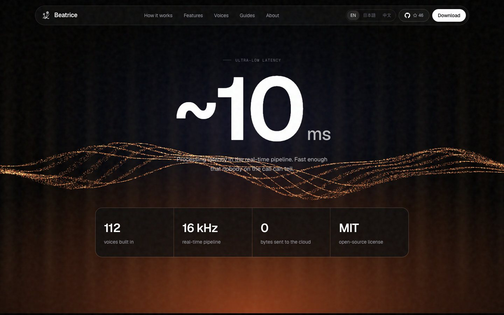<br/><sub><b>The ember band.</b> The one warm moment on the page: the voice unspooled into an amber waveform behind “~10 ms”.</sub></td>
<td width="50%">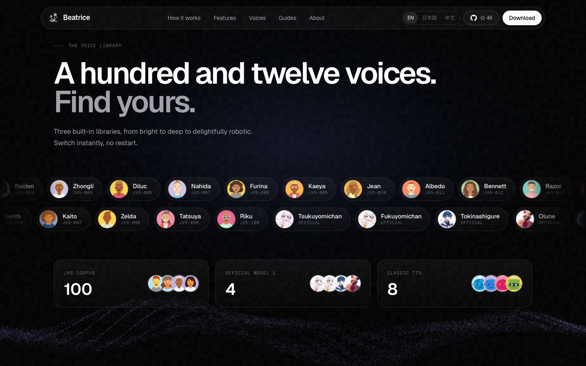<br/><sub><b>The voice library.</b> Real avatars and names, generated from the app’s own model files, so they match the app exactly.</sub></td>
</tr>
<tr>
<td width="50%">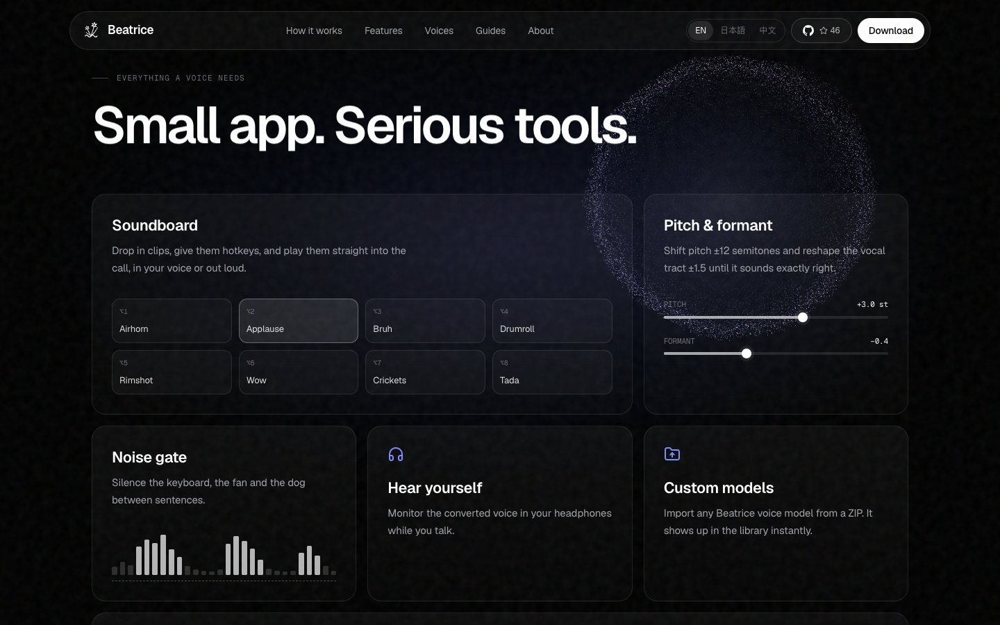<br/><sub><b>Features.</b> Each card has a small live illustration of the real control in the app.</sub></td>
<td width="50%">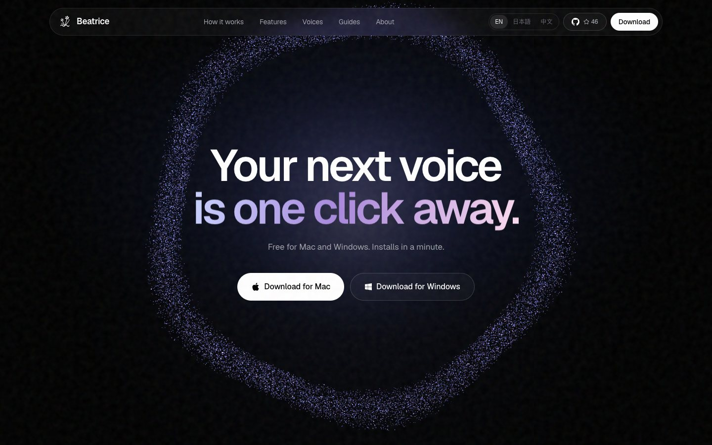<br/><sub><b>The portal.</b> The particles open into a ring around the final download.</sub></td>
</tr>
<tr>
<td width="50%">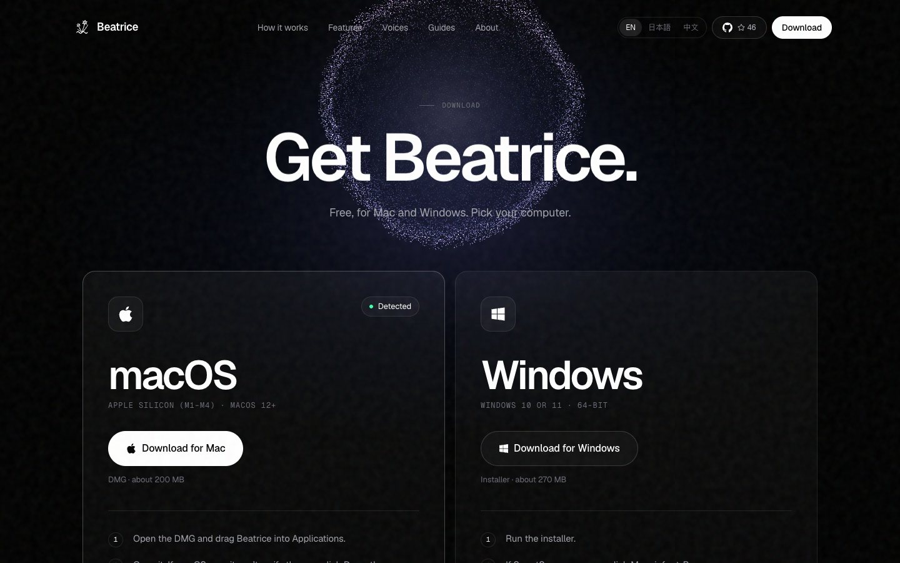<br/><sub><b>Download.</b> Detects your OS and always points at the latest release.</sub></td>
<td width="50%">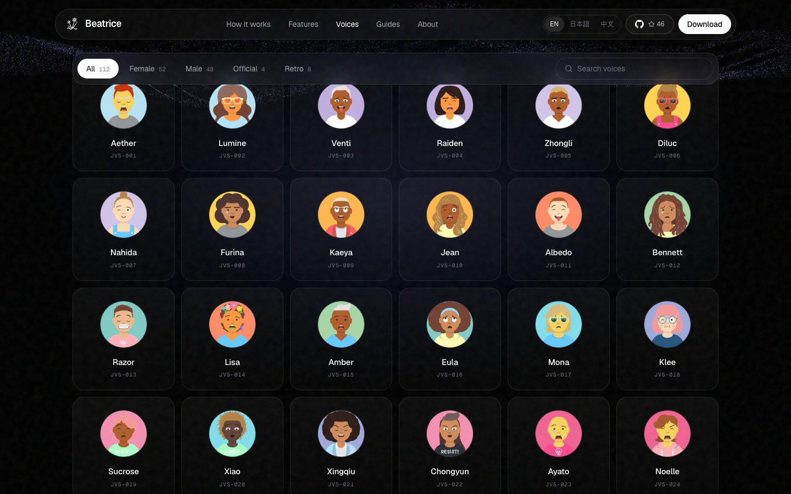<br/><sub><b>Voices.</b> All 112, filterable and searchable.</sub></td>
</tr>
<tr>
<td width="50%">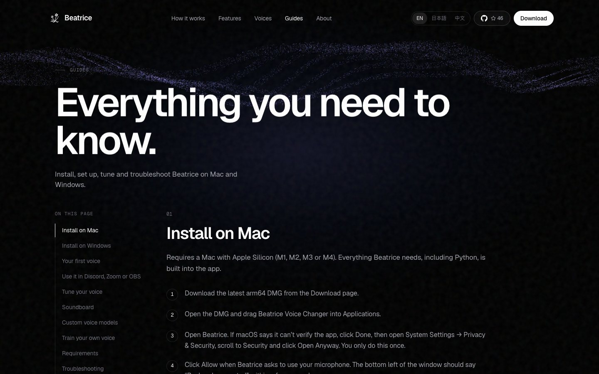<br/><sub><b>Guides.</b> Install, route to Discord/Zoom/OBS, tune, troubleshoot.</sub></td>
<td width="50%">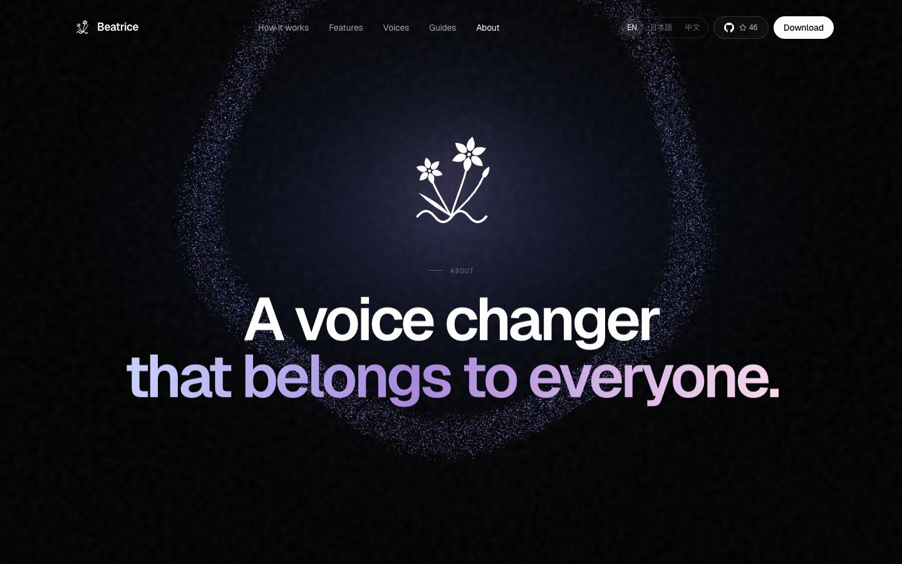<br/><sub><b>About.</b> The story, principles and the people behind the voices.</sub></td>
</tr>
</table>

<div align="center">
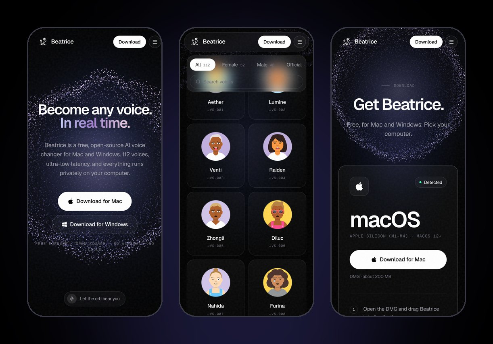

<sub>Fully responsive: the 3D scene drops to ~11,000 particles on phones.</sub>
</div>

---

## ✦ How it works

**The scroll-driven scene.** Every section declares how the voice should look while it's on screen (`data-scene`). The page maps your scroll position onto those keyframes, and the GPU blends between three shapes per particle:

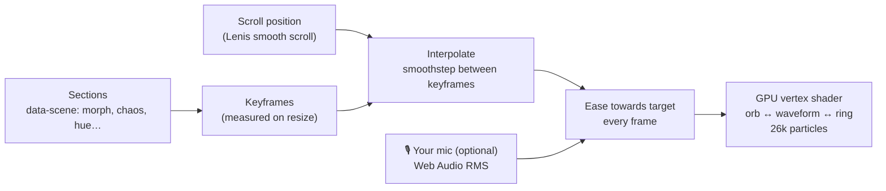

**The live star count.** The total in the nav (and the badge above) adds up every Beatrice repository, cached at Vercel's edge so visitors never hit GitHub's rate limit:

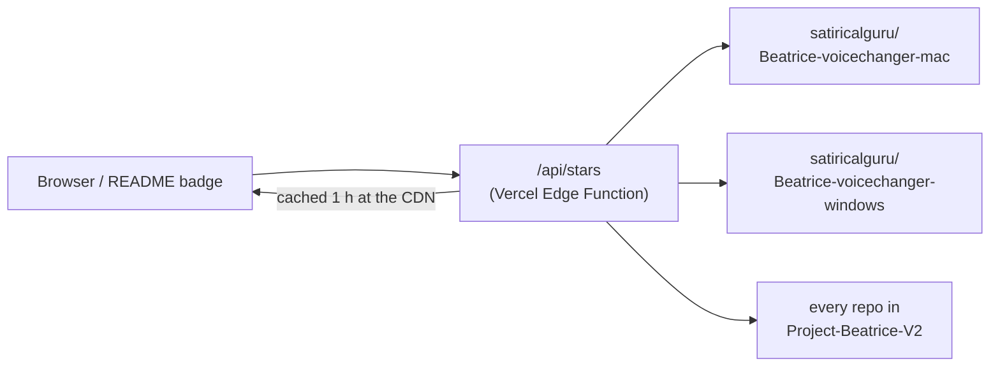

---

## ✦ Design system: "Aurora Void"

A voice is light in a dark room. The canvas is pure black. Colour lives only in the voice itself; everything around it is hairlines, frosted glass and white pills. Researched against Voicemod, voice.ai, DubbingAI and EaseUS, and the Superwhisper, V7 Labs and Active Theory design systems. Full spec in **[DESIGN.md](DESIGN.md)**.

| Token | | Use |
|---|---|---|
| `void` |  `#000000` | The canvas. Never grey. |
| `text` |  `#FFFFFF` | Text and the primary button |
| `signal` |  `#7C8CFF` | The single UI accent |
| `aurora` |  | The voice: 3D scene and hero only |
| `ember` |  | One warm band (latency), never on controls |
| `live` |  `#3DFFA8` | “Live” states only |

**Type:** [Geist](https://vercel.com/font) and Geist Mono, picked from the Awwwards free-fonts collection.

### The logo: "Sprig"

<table>
<tr>
<td align="center" width="33%">
<picture>
  <source media="(prefers-color-scheme: dark)" srcset="brand/beatrice-mark.svg">
  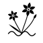
</picture>
<br/><sub>Full mark</sub>
</td>
<td align="center" width="33%"><br/><sub>App icon</sub></td>
<td align="center" width="33%"><br/><sub>Compact (favicon)</sub></td>
</tr>
</table>

The original Beatrice logo's star lilies (two open flowers, a bud and a leaf) growing out of the app's sound wave. It's generated from code ([`brand/make_sprig.py`](brand/make_sprig.py)), so every size stays pixel-consistent.

---

## ✦ Built with


<details>
<summary><b>Project structure</b></summary>

```
api/stars.ts                 Edge function: live total stars (JSON + shields badge)
brand/                       Logo sources, app icon, generator (make_sprig.py)
docs/media/                  README GIFs, video and screenshots
scripts/build-voices.mjs     Builds the voice library from the app's model files
scripts/capture-media.mjs    Captures README media from the live site (headless Chrome)
scripts/make-readme-media.py Turns captures into GIF / MP4 / JPEG
src/three/VoiceScene.ts      The particle voice: shaders, orb ↔ wave ↔ ring
src/components/SceneCanvas   Scroll → keyframes → scene
src/sections/                Home page sections
src/pages/                   Home, Download, Voices, Guides, About
src/content/{en,ja,zh}.ts    All copy, in three languages
DESIGN.md                    The design system
```
</details>

---

## ✦ Develop

```bash
git clone https://github.com/Project-Beatrice-V2/Beatrice-website.git
cd Beatrice-website
npm install
npm run dev          # http://localhost:5173
npm run build        # production build in dist/
```

<details>
<summary><b>Regenerate the voice library or README media</b></summary>

```bash
# After the app's voice models change:
node scripts/build-voices.mjs ../Beatrice-voicechanger-mac

# Re-capture GIFs and screenshots from the live site:
node scripts/capture-media.mjs https://project-beatrice.vercel.app /tmp/beatrice-media
python3 scripts/make-readme-media.py /tmp/beatrice-media
```
</details>

**Deploy:** every push to `main` deploys to [project-beatrice.vercel.app](https://project-beatrice.vercel.app/). The old address, `project-beatrice-v2.github.io/Beatrice-website/`, forwards to the same page there.

---

## ✦ The Beatrice family

| | Repository | |
|---|---|---|
| 🍎 | [Beatrice-voicechanger-mac](https://github.com/satiricalguru/Beatrice-voicechanger-mac) |  |
| 🪟 | [Beatrice-voicechanger-windows](https://github.com/satiricalguru/Beatrice-voicechanger-windows) |  |
| 🧠 | [Beatrice-trainer-macos](https://github.com/Project-Beatrice-V2/Beatrice-trainer-macos) · [windows](https://github.com/Project-Beatrice-V2/Beatrice-trainer-windows) | Train your own voice |
| ☁️ | [Beatrice-colab](https://github.com/Project-Beatrice-V2/Beatrice-colab) | Train for free in the cloud |
| 🧹 | [Beatrice-dataset-webui-macos](https://github.com/Project-Beatrice-V2/Beatrice-dataset-webui-macos) · [windows](https://github.com/Project-Beatrice-V2/Beatrice-dataset-webui-windows) | Prepare voice datasets |
| 🎭 | [Beatrice-voice-models](https://github.com/Project-Beatrice-V2/Beatrice-voice-models) | Pre-trained voices |

---

<div align="center">

**MIT licensed.** Beatrice voice engine by [prj-beatrice](https://prj-beatrice.com/). JVS corpus voices are for non-commercial use only.<br/>
Made with care by [Jatin Pandey (SatiricalGuru)](https://github.com/satiricalguru) and the Beatrice community.

<br/>

⭐ **If Beatrice made you sound like someone new, give it a star.**

</div>
